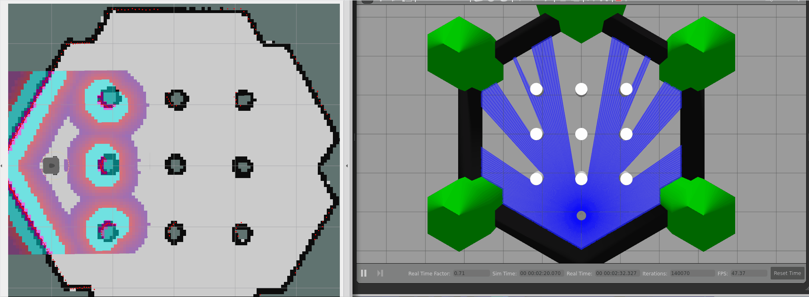
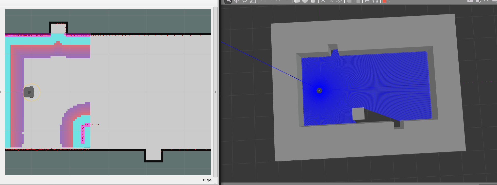

# MyDWA

**基于 ROS2 Nav2 的 C++ DWA 局部控制器**

MyDWA 是一个从零实现核心控制逻辑的 Nav2 Controller Plugin，通过 `nav2_core::Controller` 接入 Nav2。项目以 DWA 为基础，完成局部路径跟踪、静态避障与终点控制，并加入了基于 LaserScan 的动态障碍感知、轨迹风险筛选和停车让行。

**技术栈：** ROS2 Humble · Nav2 · C++17 · Gazebo Classic · TurtleBot3 Waffle

## 运行演示

**S04 · 静态障碍绕行**



**D01 · 动态障碍横穿让行**



## 核心功能

- **DWA 局部控制**：根据速度和加速度约束采样控制指令，预测轨迹，结合路径、航向、速度和障碍代价选择运动指令。
- **静态避障与终点控制**：使用 Nav2 Costmap 进行碰撞检查，并处理目标附近的减速与朝向调整。
- **动态障碍跟踪**：处理 LaserScan 聚类、跨帧关联和运动估计，按扫描时间戳同步 TF。
- **动态风险筛选**：根据障碍运动预测及已观测几何信息，过滤存在碰撞风险的候选轨迹。
- **横穿停车让行**：遇到横向穿越路径的动态障碍时停车等待，风险解除后恢复行驶。
- **准静态模式切换**：对持续关联且满足稳定观测条件的障碍，从动态让行切回普通 DWA；再次出现可信运动冲突时恢复动态处理。

### 控制流程

```text
Nav2 全局路径 ──> PathHandler ──> 速度采样 ──> 轨迹预测
                                              │
                                              v
                                       Costmap 碰撞检查
                                              │
LaserScan ──> Scan Tracker ──> 动态风险筛选 ──> 轨迹评分
                                              │
                                              v
                                        Crossing Yield
                                              │
                                              v
                                        TwistStamped
```

主要代码位于 [`src/`](src/) 和 [`include/my_dwa_controller/`](include/my_dwa_controller/)。动态让行及准静态模式切换的实现细节见 [`docs/CROSSING_YIELD.md`](docs/CROSSING_YIELD.md)。

## 测试与验证

使用 TurtleBot3 Waffle 和 Gazebo Classic，建立了直线、转弯、静态绕障、窄通道、终点控制及动态障碍等 **8 类测试场景**。

| 测试 | 结果 |
| --- | --- |
| S01–S06 静态导航场景 | 6 类场景均完成导航 |
| D01 动态障碍横穿 | 3/3 到达目标，均完成停车让行与恢复 |
| D02 临时封堵 | 3/3 到达目标，主要通过 Nav2 Recovery 恢复通行 |
| v1.2 自动化测试 | 21/21 CTest、438 个 GTest 用例通过 |
| v1.2 Gazebo 闭环验证 | 6 次有效运行通过 |

2026-10-29 的场景回归共 14 次有效运行，均到达目标，未记录 Gazebo 接触。

当前版本：[`v1.2-m-handover`](https://github.com/xiaobai6056/my-dwa-controller/tree/v1.2-m-handover)。

## 构建与使用

开发环境为 **Ubuntu 22.04 / ROS2 Humble / Nav2 / C++17**。在安装 ROS2、Nav2 及相关依赖后：

```bash
mkdir -p ~/ros2_ws/src
cd ~/ros2_ws/src
git clone https://github.com/xiaobai6056/my-dwa-controller.git

cd ~/ros2_ws
source /opt/ros/humble/setup.bash
colcon build --packages-select my_dwa_controller --cmake-args -DCMAKE_BUILD_TYPE=Release
source install/setup.bash
```

运行测试：

```bash
colcon test --packages-select my_dwa_controller
colcon test-result --verbose
```

Nav2 Controller Server 的 `FollowPath` 插件配置为 `my_dwa_controller::MyDWAController`。仓库提供两份参数文件：

- [`config/nav2_params.yaml`](config/nav2_params.yaml)：MyDWA 配置，默认启用 Scan Tracker 和 Crossing Yield。
- [`config/nav2_params_dwb.yaml`](config/nav2_params_dwb.yaml)：官方 DWB 对照配置。

动态模式需要可用的 `/scan`、TF 和里程计输入。仓库暂未包含完整的 Gazebo 场景启动脚本。

## 开发进度

正在改进更主动的动态绕障策略，包括运动障碍下的速度与轨迹选择。原型还在调试，目前通行效率不如停车让行。

已知问题：控制模式目前与插件生命周期关联，对同终点新导航任务的识别还不完善。详见 [动态控制文档](docs/CROSSING_YIELD.md)。
