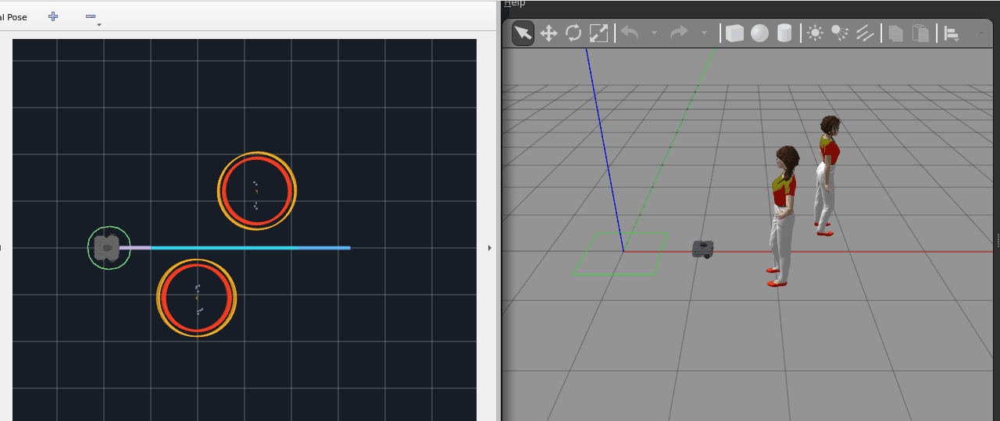
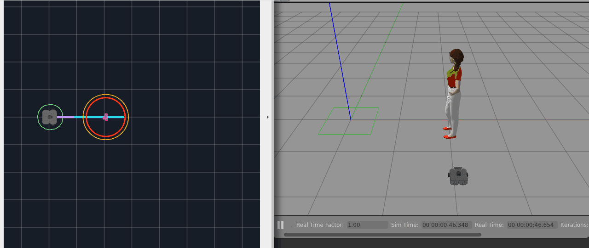

# MyDWA

**基于 ROS2 Nav2 的 C++ DWA 局部控制器（融合视觉-激光动态预测与轨迹级避障）**

MyDWA 是一个从零实现核心控制逻辑的 Nav2 Controller Plugin，通过 `nav2_core::Controller` 接入 Nav2。项目在经典 DWA 局部路径跟踪、静态避障与终点控制的基础上，引入了**相机（YOLO + SORT）与 2D LaserScan 的异步时空融合、Joseph 形式卡尔曼滤波（KF）速度估计，以及轨迹级硬红线碰撞过滤 + 速度自适应软代价评分机制**，在动态行人场景下实现了提前减速让行、同向平滑跟行与安全恢复。

**技术栈：** ROS2 Humble · Nav2 · C++17 · Python · Gazebo Classic · TurtleBot3 Waffle

## 运行演示

**M1 · 双行人错峰横穿让行**



**same-direction · 同向慢行软代价跟行**



> *注：为在 WSLg 环境下保证激光雷达与相机传感器时序的确定性，仿真后端（`gzserver`）采用软件渲染，前端（`gzclient` 与 `RViz2`）启用 GPU 硬件加速；动图中左右窗口的轻微视觉相位差源于跨渲染管线的显示延迟，底层控制环路严格稳定在 20 Hz 且全场景保持 0 接触。*

## 核心功能

- **DWA 局部控制**：按差速运动学与加减速约束采样速度指令，前向推演轨迹，结合路径贴合、航向、速度与静态代价选择控制量。
- **静态避障与终点控制**：基于 Nav2 Costmap 进行碰撞检查，并处理目标点附近的平滑减速与原地朝向收敛。
- **异步跨模态融合与 KF 运动估计**：对 15 Hz 视觉检测（YOLO + SORT）与 5 Hz LaserScan 聚类进行源时间戳对齐，并通过 Joseph 形式 Kalman Filter 估计行人位置与速度（支持短时已收敛状态滑行外推）。
- **轨迹级动态硬红线过滤**：在预测时域内对每条候选轨迹进行圆-圆中心距硬约束检查，直接淘汰高碰撞风险轨迹。
- **速度自适应软代价与丢失保护**：外层动态膨胀圆根据目标速度自适应缩放，驱动机器人提前减速或同向平滑跟行；配合目标丢失后的短时限速保护，防止预测缓存到期后的盲区急加速。

### 控制流程

```text
Nav2 全局路径 → PathHandler → DWA 速度采样 → 候选轨迹前向推演
                                                    ↓
Camera (YOLO+SORT) ──┐                      Costmap 静态碰撞检查
                     ├→ 异步时间对齐 → Joseph KF → 1.7s 轨迹硬过滤 + 自适应软代价
LaserScan 聚类 ──────┘                               ↓
                                              最优速度指令输出 (20 Hz TwistStamped)
```

主要 C++ 控制器源码位于 [`src/`](src/) 和 [`include/my_dwa_controller/`](include/my_dwa_controller/)，轻量仿真场景配置位于 [`scenarios/`](scenarios/)，演示启动脚本位于 [`scripts/run_demo_ui.sh`](scripts/run_demo_ui.sh)。

## 测试与验证

使用 TurtleBot3 Waffle 和 Gazebo Classic，建立了 **6 类静态基准场景（S01–S06）** 与 **5 类动态行人交互场景（`PERSON`、`far`、`same-direction`、`M1`、`M2`）**。封板版本（Release 构建）在全线 **33 轮**闭环回归测试中表现如下：

| 测试项 | 结果 | 关键指标说明 |
| --- | --- | --- |
| 单元测试与集成测试 | **25/25 CTest 通过** | 覆盖运动学采样、KF 更新、轨迹碰撞检查与边界保护 |
| S01–S06 静态导航基准 | **6/6 到达目标** | 直线、转弯、静态绕障、窄通道及终点控制均正常收敛 |
| `far` / `same-direction` 动态场景 | **100% 到达（0 接触）** | 同向场景最小中心距 `0.835 m`，全程平滑跟行（停等 `0.00 s`） |
| `M1` / `M2` 双行人高密度交汇 | **100% 到达（0 接触）** | 多目标独立跟踪与连续两次礼让恢复，最小中心距 `0.608 m` |
| 全量 33 轮动态+静态总计 | **32/33 到达（97.0%），0 代理接触** | 仅 `PERSON p50` 1 轮因静止贴边处估计抖动触发原地安全停等 |

**工程取舍说明：** 系统严格遵循“宁可早减速礼让，不轻易倒车硬退”的安全准则。在极个别贴近物理红线停稳的边界帧中（如 `PERSON p50`），厘米级感知抖动可能导致 `t=0` 起点出现浅重叠判定，使所有非倒车候选轨迹被过滤而进入安全停等，未发生任何代理接触。

## 构建与使用

开发环境为 **Ubuntu 22.04 / ROS2 Humble / Nav2 / C++17**。在安装 ROS2、Nav2 及相关依赖后：

```bash
mkdir -p ~/ros2_ws/src
cd ~/ros2_ws/src
git clone https://github.com/xiaobai6056/my-dwa-controller.git

cd ~/ros2_ws
source /opt/ros/humble/setup.bash
colcon build --packages-select my_dwa_controller --cmake-args -DCMAKE_BUILD_TYPE=Release
source install/setup.bash
```

运行单元测试：

```bash
colcon test --packages-select my_dwa_controller
colcon test-result --verbose
```

启动可视化演示场景（默认采用前后端渲染分离，支持 `M1`、`same-direction`、`PERSON`、`S02` 等场景，按 `Ctrl+C` 自动清理全部后台进程）：

```bash
cd ~/ros2_ws/src/my_dwa_controller
./scripts/run_demo_ui.sh M1
```

Nav2 Controller Server 的 `FollowPath` 插件配置为 `my_dwa_controller::MyDWAController`，核心参数位于 [`config/nav2_params.yaml`](config/nav2_params.yaml)。动态感知模式需要可用的 `/scan`、相机图像（或预置检测话题）、TF 与里程计输入，外部视觉权重需按 `visual_prototype/requirements.txt` 中的说明放置。

## 后续改进方向

- **浅重叠安全脱困豁免**：在保持禁止盲目倒车的前提下，针对静止且 `t=0` 存在 `< 5 cm` 浅重叠估计抖动的边界状态，允许净空沿轨迹单调增大的原地转向候选豁免通过，消除极小概率的原地自锁。
- **WSLg 传感器渲染适配**：在仿真模型中提供纯 CPU 射线雷达配置选项，使 `gzserver` 在全 GPU 硬件渲染模式下也能稳定输出有效 `/scan` 数据。
