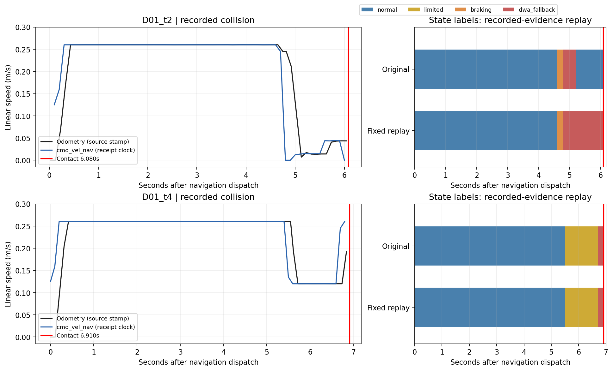

# 两次碰撞的日志与源码对照

本轮仅修复一处已复现的状态错误：DwaFallback在未对齐的新路径上立即变回Normal，绕过清障确认。此修复改善状态语义和清障滞回，**现有证据不能证明它能避免两次碰撞**。未改评分、制动参数、场景或原始结果，未新增Gazebo试验。

## 版本和时间约定

原始试验是 `benchmark/path_conflict_v01_20261022/runs/prefix_fix_D01_t2` 和 `prefix_fix_D01_t4`。两者manifest记录插件SHA256为 `9aecefa4178f7da1c4f43f4cfd053f703d614028488d1b296f1ef799125eb1c8`，Git HEAD为 `1bad3b66aa64384d5955f1933dcfb5c1017dcd62`（含未提交改动）。源码包 `sources_prefix_fix.zip` 与本轮修改前源码比较：Controller、RiskGovernor完全相同，仅Monitor已有上轮的折返路径修正。因此可以用最终Governor解释日志；不能把旧日志当作最终Monitor的闭环验证。

下面时间均为**导航派发后的仿真秒**；2s/4s为原场景名称。导航起点分别为绝对仿真时间3.4/4.2s。PATH_CONFLICT的`t`是读取时刻，不是地图更新stamp。接触和odom采用消息自身stamp；Twist无header，采用采集器最近收到的仿真clock，约0.1s量化。不能据曲线间距精确估计执行延迟。

`cap`是Governor目标上限，`applied`是Controller与可达动态窗口合并后的上限；二者都不是实际输出速度。速度响应另核对`trajectory.csv`的cmd_vel_nav及odom。

## D01 2s：减速、回退、错误恢复

原始 `benchmark/path_conflict_v01_20261022/runs/prefix_fix_D01_t2/launch.log` (external historical input, line 332)。

|时间|证据与状态|速度响应及解释|
|---|---|---|
|3.4s起|Outer出现core，但outer_risk始终为0；仍Normal|core数量增长本身不满足横向扩展判据，继续约0.26m/s。缺少分侧质心日志，不能断言具体哪个判据阻止预警。|
|4.6s，行332|Normal→Braking；Inner起点0.580m，已观测前缀1.500m；可用距离0.246m≥停车模型0.204m|cap/applied均0.245m/s，即约0.26−0.3×0.05；命令降至0.245，odom随后约0.245。并未进入WAIT。|
|4.8s，行333–338|Braking→DwaFallback；起点变0.105m，可用−0.229m，停车距离0.186m，不能认证停车；上限恢复0.26|本次420条候选全部因253 inscribed拒绝，valid=0、scored=0。插件抛出异常，随后记录到cmd_vel_nav=0，odom由约0.245降至源时间8.523s的0.007m/s。此零速属于框架异常处理链路，不是Governor等待或选中零速。|
|5.0s附近，行339–340|仍DwaFallback，Inner存在；随后DWA重新找到46条有效候选|行340输出v=0.017477m/s、w=0.124340rad/s，说明后续慢移/转向来自原DWA可行候选。|
|5.2s，行341–342|同目标重规划后，inner=0、outer=0、known=1但aligned=0；DwaFallback→Normal|这是已确认的状态漏洞：Fallback未纳入latched，清障计数即使归零也落回默认Normal。上限前后均0.26，并无该次转换直接抬高上限的证据。之后5条日志始终未对齐。|
|6.0–6.08s，行346–347及contacts|仍Normal；6.0s再次无有效候选；接触stamp为绝对9.48s，即6.08s|接触前机器人仍在缓慢运动，源9.441s速度约0.04361m/s，角速度约0.445rad/s。低速不能证明已在冲突前安全停车。|

源码对应：[RiskGovernor::decide](../../src/risk_governor.cpp#L29) 的停车认证和回退；[applyRiskPolicy](../../src/controller.cpp#L399) 的上限合并；[轨迹选择](../../src/controller.cpp#L499) 的先拒绝、后评分、无best即抛异常。

已核对cmd_vel_nav唯一发布者是controller_server。结合插件异常、服务器警告和话题零速，支持上述框架异常链路判断；本轮没有取得已安装Nav2对应的controller_server源码，未声称验证其具体实现行。

## D01 4s：预警限速、保持限制、回退后再加速

原始 `benchmark/path_conflict_v01_20261022/runs/prefix_fix_D01_t4/launch.log` (external historical input, line 339)。

|时间|证据与状态|速度响应及解释|
|---|---|---|
|5.3s，行338|Outer已有8个core但outer=0；Normal|继续约0.26m/s。|
|5.5s，行339|Normal→Limited；outer=1，inner=0；目标cap=0.12m/s|applied=0.135而非0.12，因为原acc_lim_x=2.5m/s²、dt=0.05s，可达下界约0.260087−0.125=0.135087。命令先0.135087，再0.12；odom在源9.920s约0.120076。该差值是保护可达窗口的预期行为。|
|5.7–6.3s，行340–345|Limited保持；6.3s outer=0，但known=0|仍限制0.12；没有错误恢复。|
|6.7s，行346|Limited→DwaFallback；Inner起点0.002m，可用−0.332m，停车距离0.066m；cap/applied=0.26|回退有意撤销预警限速，允许原DWA避让。实际命令先0.2450787再0.26；odom从源10.940s约0.120076升至11.042s约0.192065。命令0.245接近当前速度+原动态窗口增量0.125。|
|6.9–6.91s，行347–350及contacts|Fallback保持；6.9s的420条候选全部253拒绝，scored=0；接触stamp绝对11.11s，即6.91s|无可行轨迹异常后发生碰撞/取消。此时DWA诊断输入v=0.226058，说明实际已再次加速。|

再加速是明确的实测现象，但与原任务“不能认证停车时保留原DWA避让能力”的实现一致。没有同输入的候选级反事实或闭环对照证明保留0.12/强制零速能够避撞，所以本轮没有将其擅自改为另一种控制策略。两次均无WAIT/Recovering；关键无候选时评分尚未执行，不能归因于障碍均值稀释。

## 本次唯一生产修复及验证

- `src/risk_governor.cpp`：将DwaFallback纳入清障滞回。缺失/未知/未对齐/首次地图不解除；重复状态不累计；三个不同有效清障状态后解除。Fallback待确认时仍保留DWA上限且不允许WAIT；再次收到Outer预警时仍可转Limited。pending期间`cannot_stop=false`只表示当前没有Inner停车认证失败，不表示已清障。
- `test/test_risk_governor.cpp`：新增3个用例，覆盖日志中的重规划退锁、重复/无效证据、重新预警/冲突、4s原有回退速度范围及外部限速。修复前两个新增用例失败；修复后15个Governor用例全部通过。
- `docs/path_conflict_v01.md`：同步描述；其余业务代码和参数保持本轮开始时内容。

`analyze.py`/`replay_governor.cpp`直接链接构建后的真实Governor。原版重放31+33=64条证据，状态全部匹配。日志未逐周期记录精确速度，使用打印的停车距离反解输入速度，并对其0.001m舍入的上下界重放；三组状态一致，原版cap与日志的最大误差0.000274m/s。角速度取源stamp不晚于证据时间的odom样本；原始控制器完整输入并未保存。

修复后只改变2s在绝对8.6/8.8/9.0/9.2/9.4s的五条Normal→DwaFallback；**64条证据的修复前后速度上限全部相同，4s所有状态也相同**。这是Governor证据重放，不是地图/Controller闭环或避撞反事实，且省略了未打印的同状态控制周期；重复地图不推进清障计数，新增单测另覆盖该行为。不能推断本修复会改变真实碰撞结局。



左侧只有旧试验的实际命令/odom，未生成修复后的速度曲线；右侧是原始证据重放。色带在两条记录之间延续最后状态，不能解释为新增采样。红线为接触消息stamp。

验证结果：Release包构建成功；242个C++用例无失败，全部11个功能CTest目标通过；完整CTest为14/17，原有pep257、flake8、uncrustify三项失败。本轮修改的两个C++文件及新原生重放工具uncrustify通过，两个新Python脚本flake8/pep257通过。未修与本次问题无关的历史格式错误。日志见`final_build.log`、`tests_full.log`、`lint_scoped.log`和`tests_red.log`。

## 未证实的原因与保留边界

2s的冲突前缘由0.580m跳到0.105m是路径投影证据变化，不能直接解释成障碍运动距离。关键内部原始地图快照未保存；发布Costmap仅10/11帧，2s在关键8.0/8.2s无对应快照，只有7.8/8.4s。虽有全局plan、机器人位姿/odom及接触数据，没有逐周期实际接受的完整局部路径和完整TF bag。最终Monitor另有折返路径修正，因此也不能从这些旧图完整恢复最终检测器的输出。

所以目前不能判定前缘跳变主要来自扫描新增表面、内部地图更新、路径投影还是其组合；不能确定2s为何未形成Outer扩展；不能用发布地图频率推算内部更新频率。本轮没有据此修改阈值、扩大走廊、添加TTC或切换制动策略。

最小后续采集应在独立探针录制已有话题的基础上，针对关键周期保存实际局部路径、原始内部地图快照标识和检测使用的侧向统计，先补齐因果链，再决定是否改变回退策略；发布Costmap仍只能作为外部观察。此处只是建议，本轮未实现或运行。

## 复现与回滚

工作根为 `${MYDWA_WS}`。构建及验证命令：

```bash
source /opt/ros/humble/setup.bash
cd ${MYDWA_WS}
colcon --log-base log_path_conflict_v01 build --build-base build_path_conflict_v01 --install-base install_path_conflict_v01 --packages-select my_dwa_controller --cmake-args -DCMAKE_BUILD_TYPE=Release -DBUILD_TESTING=ON
source install_path_conflict_v01/setup.bash
cd build_path_conflict_v01/my_dwa_controller
ctest --output-on-failure
cd ${REPO_ROOT}/benchmark/path_conflict_collision_review_20261022
python3 -B analyze.py --label after
python3 -B plot_review.py
```

`before.json`保存工作区初始状态和5840个文件哈希；`sources_before.zip`保存本轮前源码，`incremental.patch`只含本次改动，`final_manifest.json`保存最终版本、验证及原数据完整性检查。原始试验与旧归档不覆盖。`*_observed.csv`带原日志行号；`*_{before,after}_{low,mid,high}.csv`为派生重放数据。

回滚本修复可对`incremental.patch`先执行`git apply --reverse --check`，通过后再反向应用；不要reset整个工作区。功能仍默认关闭，可按原文档禁用并重新configure。不要在当前修复源码上重新生成`--label before`：该标签的现存结果对应归档中的原Governor和保留的原生可执行文件。
