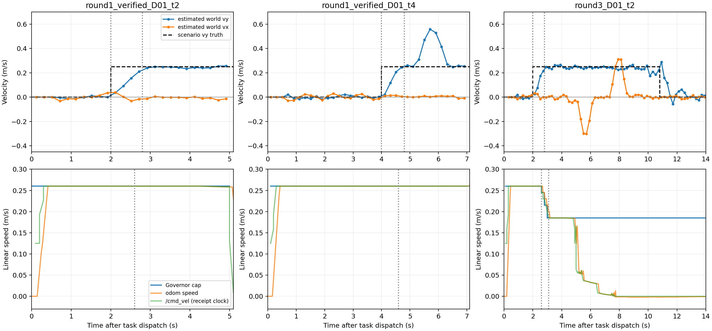
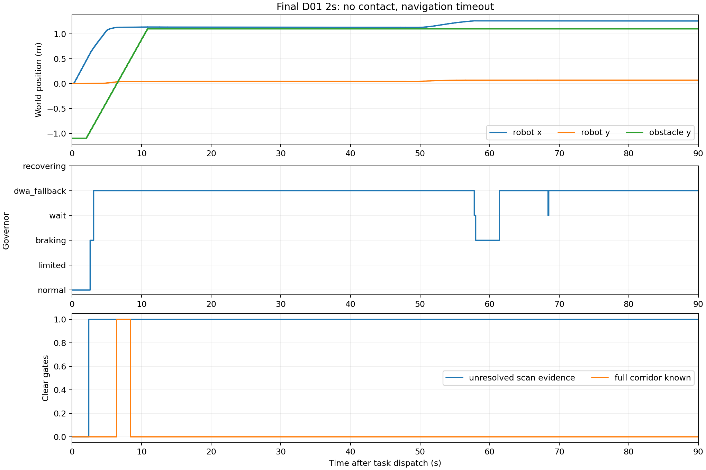

# MyDWA Scan 动态障碍：实现、三轮验证与未解决问题

**结论：端到端代码已实现，短时运动趋势、路径冲突和限速有真实证据；动态避障尚未解决。**
第一轮两次D01碰撞。定向修正后S05成功；最后D01 2s没有接触，但90s仿真导航超时，
没有形成可靠的动态等待后恢复通行。保留默认关闭，未修改正式场景/正式参数/旧归档。

## 1. 当前源码核对与实际改动

基于HEAD `1bad3b66aa64384d5955f1933dcfb5c1017dcd62` 加本轮开始时已有的未提交改动，
不是基于旧报告重做DWA。初始6761个文件哈希、git状态和源码见before.json、
git_status_before.txt、sources_before.zip；最终增量补丁相对于这份初始快照。

核对了Controller生命周期/共享TF、docs/path_conflict_v01.md、当前Monitor/Governor、
软偏好、D01/D02生成/运动脚本及最近三份实验报告。Controller原本没有scan订阅。
原Monitor是世界格心历史比较，不是物体跟踪；原Fallback软偏好仍保留。

- 新增 `scan_obstacle_tracker.hpp/.cpp`：原TF buffer、固定odom源时间变换、无效点过滤、
  邻接聚类/360°接缝、短时关联、尺寸/位置/速度/可信度、丢失与过期处理。
- 修改 `path_conflict_monitor.hpp/.cpp`：optional scan证据、局部路径关系、短时冲突区域；
  保留Costmap当前占据，scan模式由scan提供运动证据，统一送入同一Governor。
- 修改 `risk_governor.cpp`：scan丢失/不新鲜/重获但不可靠不能清障；已减速后的不可停车
  回退保留限速。旧scan-disabled策略不变。
- 修改 `controller.hpp/.cpp`：生命周期订阅组织、每周期数据流、日志和软边界采样约束。
  未修改Sampler、Predictor、ObstacleEvaluator、Scorer的算法或权重。
- CMake/package增加sensor_msgs、独立感知静态库和GTest；原测试追加集成/回归。
- 两份文档和本目录实验适配/分析/绘图工具。不创建新Benchmark或改原场景。

实际D01是0.5×0.5×0.7m**方柱**，不是圆柱；+Y规定速度0.25m/s，横坐标1.6m。
D02是0.4×0.8×0.7m方柱，进入通道为−Y 0.25m/s，停留后反向离开。
没有改这些几何/启动/运动条件。圆柱支持由真实射线圆交合成扫描单测验证。

真实录包：`/scan` frame=`base_scan`，中位源stamp间隔0.200s，360光束，
time_increment=0、scan_time=0；使用仿真ROS时间。所有4次有效运行的tracker TF失败计数为0。
scan源时刻变换到odom，没有latest TF替代。控制输入没有使用Gazebo真值或启动时刻。

## 2. 实验规模、版本与每轮结果

共**三轮有效测试、4次有效Gazebo闭环，另有2次被版本保护拦截的无效启动，总计6次启动**。
所有运行独立目录、参数副本、源码ZIP、插件SO、manifest、launch/trial日志与scan/TF bag。
4次有效运行均valid=true、实际插件映射核验通过、清理返回0。两次碰撞仍属有效失败样本。

|轮次/条件|插件|结果|主要证据|
|---|---|---|---|
|第一轮 D01 2s|V1|碰撞，导航后5.14s接触|2.6s预测冲突进入Fallback；错误的过近冲突位置阻止提前停车|
|第一轮 D01 4s|V1|碰撞，导航后7.11s接触|4.6s预测冲突进入Fallback；可见表面变化使速度明显高估|
|第二轮 S05|V2|导航成功，31.8s|261条风险记录均Normal，没有scan冲突或持续可信运动簇|
|第三轮 D01 2s|V2|无接触，90.1s导航后因sim_timeout取消|2.6s Braking、3.1s Fallback保留0.185上限；长期不恢复|

V1 SHA256：`cdf08592184f08cac272fe0cc69ee3f972555ccd48c8a7a74707a5fcbe00fb0e`

V2/最终插件 SHA256：`af3ea574b5715eae784f8b307b4d56e29a945e8452e094c719811026df183605`

源码/插件/参数的逐文件关系在每个runs/*/manifest.json、sources.zip、
libmy_dwa_controller.so、params_enabled.yaml；最终独立前缀也在final_manifest.json。
Git HEAD相同不足以标识这些dirty版本，必须使用上述哈希与源码ZIP。

无效启动保留在round1_D01_t2/round1_D01_t4。原因是本次启动时先source新overlay、
原启动脚本再source旧underlay，ament环境去重使旧插件优先。保护检查在dispatch前
取消两次启动，original runner的“user canceled during preflight”是监督器清理结果，
不是用户手动取消。已在独立启动副本显式前置选定前缀，保留原脚本不改。

## 3. 运动估计有效性：有成功区间，也有严重失真

用Gazebo观测位置与**源stamp对齐的TF**估计world←odom，只用于离线评价；不回放，
不发布消息。GT ModelStates无源stamp，原collector用接收clock记录，量化约0.1s。
两次第一轮GT首次明显位移均比规定启动晚约0.1s，不能把下面0.083/0.090s的
扫描数据年龄当作精确物理感知延迟。0.8s拟合窗还带来约半窗的趋势平均/启动滞后。

按真值空间位置给簇ID离线标签，不按估计方向或误差筛选ID。所有同ID观测都写入
actor_aligned.csv；完整运动区间和“启动0.8s后且confidence≥0.65”的区间均报告。
方向正确仅是必要条件，二维RMSE包括不应存在的X方向速度。

|运行|有效区间（导航后）|样本|vy中位数|二维速度RMSE|主要限制|
|---|---|---:|---:|---:|---|
|第一轮2s，启动后0.8s以上且可信|2.917～4.917s|11|0.244m/s|0.0134m/s|连续0.2s，vy范围0.234～0.257，vx中位−0.0068|
|第一轮4s，相同规则|4.91～6.91s|9|0.260m/s|0.1405m/s|vy峰值0.558，高置信度仍高估；最大观测间隔0.4s|
|第三轮2s，相同规则|2.92～10.72s|37|0.241m/s|0.1084m/s|Y趋势大多合理，但可见面改变带来约±0.3m/s伪X趋势|

规定移动真值均为(vx,vy)=(0,0.25)m/s。第一轮2s完整移动观测区间15点的RMSE
0.0758m/s，包含启动过渡；4s完整区间15点RMSE0.1476m/s；第三轮完整区间44点
RMSE0.1223m/s。没有只挑方向符号正确的点宣称可靠。

第一轮2s的可靠短区间证实了连续、时间对齐合理的短时趋势；但方柱换面/遮挡/聚类
支持变化使包围盒中心滑动，低残差并不代表物体真实速度正确。第一轮4s位置偏差
中位约0.273m，2s约0.039m，第三轮约0.047m。这里是**可见簇中心/尺寸估计**，
没有完整物体中心和隐藏尺寸重建；对所有姿态都可靠的预测尚未成立。



## 4. 冲突判断有效性与控制接入有效性（分别判断）

**冲突判断已经使用运动估计。** `[SCAN_TRACK]`中的速度、预测相交时间和路径关系
进入`mergeScan`，修改`ConflictEvidence.inner_conflict/inner`，不是只打印日志。
第一轮2s在launch.log:356出现core=0/0、predicted=1、inner=1；4s在:427同样如此。
第三轮在launch.log:360（绝对sim5.9、相对2.6）出现：

```
state=braking core=0/0 inner=1 region=0.781:1.798
cap=0.245 stop=0.204 available=0.446 scan=1 fresh=1 predicted=1
```

原Costmap-only Inner在这些周期没有冲突格心，路径预测证据实际改变Governor输入。
解析路径段相交的稀疏/密集等价测试验证纵向位置不因路径采样密度改变。

**控制接入已产生实际限速。** 第三轮2.6s进入Braking，3.1s（launch.log:380）因
available不足转Fallback、硬上限保留0.185m/s。首次低于0.25的cmd_vel就在2.6s；
源stamp odom在触发前0.3s中位0.2601m/s，触发后0.2～0.6s中位0.2152m/s。
真实发布scan→插件→Wait零速、相同目标重规划保持、deactivate取消订阅及再次activate
重新等待观测，都由真实插件集成单测覆盖；没有用测试专用感知注入接口。

第一轮两次Fallback均没有提前减速，不能将进入风险状态等同于有效限速。
最后一次仅有很晚的两条Wait状态记录（57.8s、68.4s），此时障碍早已停止横穿，
应按静态环境误触发/可见面漂移处理，**不构成动态等待成功证据**。未观测到Recovering。

## 5. 闭环失败层次与定向修正

第一轮失败后只作根因修正，没有调阈值：

1. Monitor在密集路径上使用每段截断投影后再扣尺寸，重复提前冲突位置，导致停车
   许可被错误拒绝。增加稀疏/密集等价失败测试，再改为预测圆盘/路径段解析入点。
2. 代码审查发现：已知运动簇重获但短窗拟合未建立时，可暂时被当作清障。失败测试
   复现后，使这种情况继续unresolved，直到当前拟合可靠。
3. 代码审查发现：保留硬上限后，旧软边界补样假设失效，可补出越限候选。
   真实插件失败测试复现0.20>0.185，修正为仅补实际采样窗口内的软边界。

三项测试先失败后通过，日志tests_regressions_red.log、tests_roots.log。
阈值、场景时序、评分和清障覆盖条件没有改。

第三轮没有接触，GT近似polygon gap最小0.0451m，但这是单次不同初始感知状态的
闭环，**不能把它当作同步反事实或统计避撞改善**。失败落在：可见簇运动假象、丢失
未决状态、原完整走廊覆盖不足、风险限行后的恢复。完整走廊known在800条风险记录中仅20条为1（导航后6.4～8.2s），此时
仍存在风险/未决证据；障碍离开后的长期记录又缺乏完整覆盖，不能满足原清障条件。unresolved标志又对任何曾运动的丢失簇保守
保留，因此不保证能恢复。没有放松这些条件来制造成功。



本次“超时”是原导航90s总时限，不能写成模块内部WAIT定时器超时。S05没有误触发，
但第三轮后段已有静态运动误判，因此不能概括为“静态零误报”。

## 6. 工程验证

- Release构建成功：build_round2_final.log，独立build_scan_trend/install_scan_trend。
- 相关功能CTest：12/12通过，260个C++用例通过，tests_round2_final.log，含原有Benchmark/插件关闭签名。
- 完整CTest：15/18通过，tests_full.log；pep257、flake8、uncrustify失败，未写成全绿。
  最终失败来自旧benchmark/诊断脚本和C++探针；本轮脚本初次也有格式问题，已修正，
  三个本轮Python工具均独立通过flake8/pep257。最终完整检查见tests_full_final.log。
- 定向C++格式：11个新增/修改文件全部通过，style_scoped.log。只格式化改动文件，
  没有整理旧实验探针；新增/修改Python工具flake8/pep257独立通过。
- 独立审查发现上述两项重要缺陷，均已修正并复审；不是用审查替代测试。
- 初始6761文件中仅12个预期文件改动，旧Benchmark/配置文件逐一哈希无变化。
  260个C++用例全部通过；源/插件/测试哈希见final_manifest.json；各验证命令的真实返回码见verification.json。

## 7. 复现与交付目录

```
source /opt/ros/humble/setup.bash
cd ${MYDWA_WS}
colcon --log-base log_scan_trend build --build-base build_scan_trend \
  --install-base install_scan_trend --packages-select my_dwa_controller \
  --cmake-args -DCMAKE_BUILD_TYPE=Release -DBUILD_TESTING=ON
source install_scan_trend/setup.bash
cd build_scan_trend/my_dwa_controller
ctest -R test_ --output-on-failure
ctest --output-on-failure
```

运行适配器 `run_round.py --cases D01_t2 D01_t4 --tag <新的目录前缀> --domain 103`，
或S05；本轮现有tag不可复用，工具拒绝覆盖。无需额外加载旧/新overlay来启动；
独立启动副本确保选定前缀优先，运行中再次核验实际映射。
所有参数仅在params_enabled.yaml副本。原始Benchmark/旧日志都只读取。

`analysis.json`是全6次启动汇总；每个有效run有tracks_all.csv、risk_all.csv、
actor_aligned.csv（动态）、scan_metadata.csv与原始bag/trial/launch.log。
`control_effects.json`、两幅图和分析脚本给出可复核的速度与控制证据。
`incremental.patch`只含本轮相对初始dirty源码的差异；未提交或重置原改动。

## 8. 下一步建议（本轮不继续Gazebo）

1. 优先离线修正方柱换面/遮挡导致的中心漂移：用表面几何一致性或稳定尺寸模型
   约束位置/速度，将“拟合线性但物理关联不可信”显式标为未知，不能单靠残差。
2. 将丢失证据关联到先前的路径风险对象，并用真实扫描射线可见性证明区域被清空；
   不用任意超时删除风险，也不要让无关远墙碎片永久阻止恢复。
3. 对原完整走廊覆盖条件和局部map窗口作独立几何诊断，保留严格清障证据；确认
   合理的观测覆盖后，才评估恢复策略。不能把短暂重规划视为清障。
4. 在同一份源stamp扫描/TF/路径上比较修正前后，再追加有明确目的的闭环。
   当前没有实体机器人制动/延迟标定、复杂多目标、全局定位跳变或压力验证。
